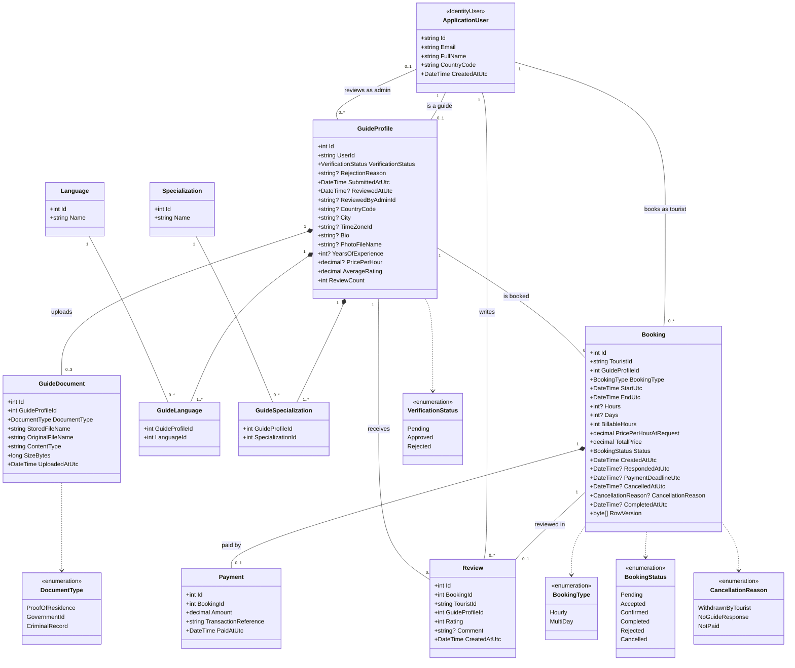
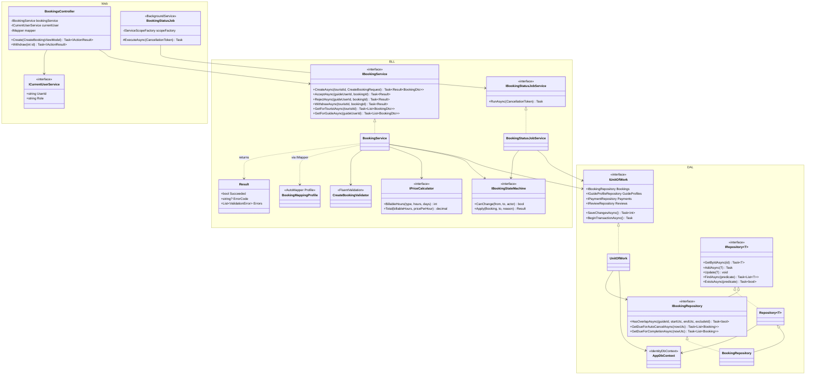

# Tour Guide Booking — Class Specs

Nov 6, 2026 · @mohab

## At a glance

The system has 10 classes, plus 5 enums. **Booking** is the center: it links a tourist to a guide, and each booking has at most one payment and one review.

See `docs/class-diagram.md` → 3.1 Relationships at a glance.

Review also stores the tourist and guide IDs for fast lookups. The two join classes (GuideLanguage, GuideSpecialization) sit on the many-to-many lines.

## Conventions

These rules apply to every class below, so each class lists only what is special about it.

- **Source:** every class traces back to the SRS (FR-01 to FR-20, BR-01 to BR-15, and the assumptions in section 7).
- **IDs:** `int` primary key named `Id`, generated by the database. The exception is `ApplicationUser`, which uses the ASP.NET Core Identity `string` key.
- **Dates and times:** stored as `DateTime` in UTC, with names ending in `Utc`. The guide's time zone converts them for display.
- **Money:** `decimal(10,2)`, always in USD.
- **Text:** every `string` has a maximum length. "Required" means the database column is NOT NULL.
- **Enums:** stored as `int`. The values are listed in the Enums section.
- **Deleting:** nothing is deleted in the MVP. Records change status instead, so history stays complete.

## 1. ApplicationUser

One account class for all three actors. It extends `IdentityUser`, so email, password hash and roles come from ASP.NET Core Identity. The role (Tourist, Guide, Admin) is an Identity role, not a property.

**Properties** (besides the inherited Identity ones)

| Property | Type | Required | Notes |
| --- | --- | --- | --- |
| Id | string | Yes | Inherited from Identity |
| Email | string(256) | Yes | Inherited; unique; used to log in |
| FullName | string(100) | Yes |  |
| CountryCode | string(2) | Yes | ISO 3166 code, e.g. `EG`, `DE` |
| CreatedAtUtc | DateTime | Yes | Set on sign-up |

**Relationships**

- 1 to 0..1 `GuideProfile` (only users with the Guide role have one)
- 1 to many `Booking` as the tourist
- 1 to many `Review` as the author
- 1 to many `GuideProfile` as the reviewing admin (`ReviewedByAdminId`)

**Validation**

- Email: valid format, unique.
- Password: Identity defaults (at least 6 characters, with a digit, an uppercase and a lowercase letter).
- FullName: 2 to 100 characters.
- CountryCode: must be one of the countries in the app's country list.
- Public sign-up can create only the Tourist or Guide role. Admin accounts are seeded.

**Traces to:** FR-01, FR-02, FR-03 · Assumptions: tourist sign-up fields, admin accounts

## 2. GuideProfile

Everything about a guide beyond the login account: verification status, public profile, and price. It is created at guide sign-up with status Pending. The public fields are filled after approval (FR-08), so they are nullable in the database.

**Properties**

| Property | Type | Required | Notes |
| --- | --- | --- | --- |
| Id | int | Yes |  |
| UserId | string | Yes | FK to `ApplicationUser`; unique |
| VerificationStatus | VerificationStatus | Yes | Starts as `Pending` |
| RejectionReason | string(500) | No | Required when status is `Rejected` |
| SubmittedAtUtc | DateTime | Yes | Updated on each re-apply |
| ReviewedAtUtc | DateTime | No | Set when the admin decides |
| ReviewedByAdminId | string | No | FK to `ApplicationUser` (admin) |
| CountryCode | string(2) | No | Country where they guide; search filter |
| City | string(100) | No |  |
| TimeZoneId | string(64) | No | IANA name, e.g. `Africa/Cairo`; used for trip times |
| Bio | string(1000) | No |  |
| PhotoFileName | string(260) | No | Stored file name, not a URL |
| YearsOfExperience | int | No |  |
| PricePerHour | decimal(10,2) | No | USD |
| AverageRating | decimal(3,2) | Yes | Default 0; recalculated on each new review |
| ReviewCount | int | Yes | Default 0 |

**Relationships**

- 1 to 1 `ApplicationUser`
- 1 to many `GuideDocument` (one current file per document type)
- many to many `Language` through `GuideLanguage`
- many to many `Specialization` through `GuideSpecialization`
- 1 to many `Booking`
- 1 to many `Review`

**Validation**

- RejectionReason: required (10 to 500 characters) when the admin rejects.
- A guide can be approved only when all 3 document types are uploaded.
- PricePerHour: greater than 0 and at most 1,000.
- YearsOfExperience: 0 to 60.
- Bio: at most 1,000 characters.
- At least one language and one specialization.
- Photo: JPG or PNG, at most 5 MB.
- **Profile complete** = CountryCode, City, TimeZoneId, PricePerHour, at least one language and one specialization are all set.

**Rules this class enforces**

- Shown in search and bookable only when `Approved` **and** the profile is complete.
- Re-apply: allowed only from `Rejected`. It sets the status back to `Pending`, updates `SubmittedAtUtc` and clears the review fields.
- `AverageRating` and `ReviewCount` change only when a `Review` is added.

**Traces to:** FR-02, FR-04 to FR-10, FR-20 · BR-01, BR-02 · Assumptions: rejection reason, re-applying, profile fields, currency, time zone

## 3. GuideDocument

One uploaded verification file. A guide has exactly one current file per document type. Uploading again on re-apply replaces the old file.

**Properties**

| Property | Type | Required | Notes |
| --- | --- | --- | --- |
| Id | int | Yes |  |
| GuideProfileId | int | Yes | FK to `GuideProfile` |
| DocumentType | DocumentType | Yes |  |
| StoredFileName | string(260) | Yes | A new GUID plus extension; never the user's file name |
| OriginalFileName | string(260) | Yes | Shown to the admin only |
| ContentType | string(100) | Yes | `application/pdf`, `image/jpeg` or `image/png` |
| SizeBytes | long | Yes |  |
| UploadedAtUtc | DateTime | Yes |  |

**Relationships**

- many to 1 `GuideProfile`

**Validation**

- (GuideProfileId, DocumentType) is unique.
- File type: PDF, JPG or PNG. Check the file content, not only the extension.
- SizeBytes: greater than 0 and at most 5 MB (5,242,880 bytes).

**Rules this class enforces**

- Files are saved outside `wwwroot`. Only an Admin can download them, through an authorized action.
- Uploading is allowed only while the guide is `Pending` (at sign-up) or `Rejected` (to re-apply).

**Traces to:** FR-02, FR-05 · BR-03 · NFR-02 · Assumption: document files

## 4. Language, Specialization and join classes

Two lookup lists that the search filters use, each linked to guides through a join class. Both lists are seeded and are not edited in the MVP.

**Language**

| Property | Type | Required | Notes |
| --- | --- | --- | --- |
| Id | int | Yes |  |
| Name | string(50) | Yes | Unique, e.g. English, Arabic, German |

**Specialization**

| Property | Type | Required | Notes |
| --- | --- | --- | --- |
| Id | int | Yes |  |
| Name | string(50) | Yes | Unique, e.g. History, Diving, Desert safari |

**GuideLanguage** and **GuideSpecialization** (join classes)

| Property | Type | Required | Notes |
| --- | --- | --- | --- |
| GuideProfileId | int | Yes | Part of the composite key |
| LanguageId / SpecializationId | int | Yes | Part of the composite key |

**Relationships**

- `GuideProfile` many to many `Language` through `GuideLanguage`
- `GuideProfile` many to many `Specialization` through `GuideSpecialization`

**Validation**

- Name: unique, 2 to 50 characters.
- A guide cannot pick the same language or specialization twice (composite key).

**Traces to:** FR-08, FR-10

## 5. Booking

The main class of the system. A booking goes from the tourist's request to completion, and its status follows only the transitions in the table below.

**Properties**

| Property | Type | Required | Notes |
| --- | --- | --- | --- |
| Id | int | Yes |  |
| TouristId | string | Yes | FK to `ApplicationUser` |
| GuideProfileId | int | Yes | FK to `GuideProfile` |
| BookingType | BookingType | Yes | `Hourly` or `MultiDay` |
| StartUtc | DateTime | Yes | MultiDay: 00:00 guide local time on the first day |
| EndUtc | DateTime | Yes | Hourly: StartUtc + Hours. MultiDay: 00:00 guide local time on the day after the last day |
| Hours | int | No | Hourly only |
| Days | int | No | MultiDay only |
| BillableHours | int | Yes | Hourly: Hours. MultiDay: Days × 8 |
| PricePerHourAtRequest | decimal(10,2) | Yes | Copied from the guide when the request is sent |
| TotalPrice | decimal(10,2) | Yes | BillableHours × PricePerHourAtRequest |
| Status | BookingStatus | Yes | Starts as `Pending` |
| CreatedAtUtc | DateTime | Yes |  |
| RespondedAtUtc | DateTime | No | When the guide accepted or rejected |
| PaymentDeadlineUtc | DateTime | No | Set on accept: the earlier of RespondedAtUtc + 24 h and StartUtc |
| CancelledAtUtc | DateTime | No |  |
| CancellationReason | CancellationReason | No | Required when status is `Cancelled` |
| CompletedAtUtc | DateTime | No |  |
| RowVersion | byte\[\] | Yes | Concurrency token, so two status changes cannot overwrite each other |

**Relationships**

- many to 1 `ApplicationUser` (tourist)
- many to 1 `GuideProfile`
- 1 to 0..1 `Payment`
- 1 to 0..1 `Review`

**Validation (when the request is sent)**

- The guide is `Approved` and the profile is complete.
- Hourly: Hours is 2 to 10, and the trip ends on the same local day it starts. Days is empty.
- MultiDay: Days is 2 to 14. Hours is empty.
- StartUtc is at least 24 hours after now.
- TouristId is the logged-in user, who has the Tourist role.

**Allowed status changes**

| From | To | Who | Condition |
| --- | --- | --- | --- |
| Pending | Accepted | Guide (owner) | No overlap with the guide's other Accepted or Confirmed bookings |
| Pending | Rejected | Guide (owner) |  |
| Pending | Cancelled | Tourist (owner) | Reason `WithdrawnByTourist` |
| Pending | Cancelled | System | 24 h after CreatedAtUtc; reason `NoGuideResponse` |
| Accepted | Confirmed | Tourist (owner) | Paid before PaymentDeadlineUtc; creates a `Payment` |
| Accepted | Cancelled | Tourist (owner) | Reason `WithdrawnByTourist` |
| Accepted | Cancelled | System | PaymentDeadlineUtc passed; reason `NotPaid` |
| Confirmed | Completed | System | EndUtc passed |

Rejected, Cancelled and Completed are final. Any other change is refused.

**Overlap rule:** two bookings overlap when `A.StartUtc < B.EndUtc` and `B.StartUtc < A.EndUtc`.

**Traces to:** FR-11 to FR-18 · BR-04 to BR-11 · NFR-05 · Assumptions: multi-day price, price changes, request limits, advance notice, unanswered requests, overlapping requests, withdrawing, time zone

## 6. Payment

The record of a simulated payment. It holds no card data at all (NFR-04): the card fields on the payment screen are checked for format and then thrown away.

**Properties**

| Property | Type | Required | Notes |
| --- | --- | --- | --- |
| Id | int | Yes |  |
| BookingId | int | Yes | FK to `Booking`; unique |
| Amount | decimal(10,2) | Yes | USD |
| TransactionReference | string(36) | Yes | A new GUID, shown to the tourist as a receipt number |
| PaidAtUtc | DateTime | Yes |  |

**Relationships**

- 1 to 1 `Booking`

**Validation**

- The booking is `Accepted`, belongs to the logged-in tourist, and PaymentDeadlineUtc has not passed.
- Amount equals the booking's TotalPrice.
- Only one payment per booking (unique BookingId).

**Rules this class enforces**

- Saving the payment and changing the booking to `Confirmed` happen in one database transaction.

**Traces to:** FR-14 · BR-07, BR-08, BR-12 · NFR-04

## 7. Review

A tourist's rating of a guide for one completed booking.

**Properties**

| Property | Type | Required | Notes |
| --- | --- | --- | --- |
| Id | int | Yes |  |
| BookingId | int | Yes | FK to `Booking`; unique |
| TouristId | string | Yes | FK to `ApplicationUser` |
| GuideProfileId | int | Yes | FK to `GuideProfile`; copied from the booking so profile pages load fast |
| Rating | int | Yes | 1 to 5 |
| Comment | string(1000) | No |  |
| CreatedAtUtc | DateTime | Yes |  |

**Relationships**

- 1 to 1 `Booking`
- many to 1 `ApplicationUser` (tourist)
- many to 1 `GuideProfile`

**Validation**

- The booking is `Completed`.
- TouristId is the booking's tourist and the logged-in user.
- One review per booking (unique BookingId).
- Rating: whole number from 1 to 5. Comment: at most 1,000 characters.

**Rules this class enforces**

- Saving a review updates the guide's AverageRating and ReviewCount in the same transaction.
- Reviews cannot be edited or deleted in the MVP.

**Traces to:** FR-09, FR-19, FR-20 · BR-13, BR-14, BR-15 · Assumption: rating scale

## 8. Enums

| Enum | Values (stored as int) | Used by | Traces to |
| --- | --- | --- | --- |
| VerificationStatus | Pending = 0, Approved = 1, Rejected = 2 | GuideProfile | FR-06, FR-07, BR-01 |
| DocumentType | ProofOfResidence = 0, GovernmentId = 1, CriminalRecord = 2 | GuideDocument | FR-02 |
| BookingType | Hourly = 0, MultiDay = 1 | Booking | FR-11, BR-04 |
| BookingStatus | Pending = 0, Accepted = 1, Confirmed = 2, Completed = 3, Rejected = 4, Cancelled = 5 | Booking | BR-05 |
| CancellationReason | WithdrawnByTourist = 0, NoGuideResponse = 1, NotPaid = 2 | Booking | FR-17, BR-06 to BR-08 |

Roles are not an enum. They are Identity roles with fixed names: `Tourist`, `Guide`, `Admin`, kept as string constants in one `Roles` class.

## 9. Decisions to approve

These 10 design choices go beyond what the SRS says. Approve them, or change any row, before the Entities and DbContext are written.

| # | Decision | Why | Alternative |
| --- | --- | --- | --- |
| 1 | One `ApplicationUser` for everyone, plus a `GuideProfile` for guides only. No `TouristProfile`. | Tourists have only 2 extra fields | A separate `TouristProfile` class |
| 2 | A guide's working country and city live on `GuideProfile`, apart from the account's country. | A guide may live in one place and guide in another | Use the account's country for both |
| 3 | Multi-day trips are whole calendar days in the guide's time zone. | Makes overlap checks simple | Let the tourist pick start and end hours each day |
| 4 | An hourly trip must end on the same day it starts. | Matches "hours on one day" in BR-04 | Allow trips past midnight |
| 5 | `AverageRating` and `ReviewCount` are stored on the guide and updated with each review. | Search can sort and filter by rating fast | Calculate them in every query |
| 6 | Re-uploading a document replaces the old file. No history is kept. | Simpler; the admin sees one file per type | Keep every version |
| 7 | `Payment` is its own class, not fields on `Booking`. | Easy to swap in a real gateway later | Put PaidAt and the reference on Booking |
| 8 | Limits: price 0 to 1,000 USD per hour, experience 0 to 60 years, rejection reason at least 10 characters. | Stops obviously wrong data | Other limits you choose |
| 9 | Nothing is deleted, and reviews cannot be edited. | Keeps booking and review history complete | Allow edits or deletes |
| 10 | Languages and specializations are seeded lists. The admin cannot edit them in the MVP. | No extra admin screens needed | Admin pages to manage the lists |

## 10. UML class diagrams

The domain model with every property, and the path of the Booking feature through the 3 layers. The same Mermaid source is in the project at `docs/class-diagram.md`.

### 10.1 Domain model

`*--` is composition, `--` is association, and `..>` means the class uses that enum. `1..*` on the join classes applies to a complete profile.

### 10.2 Layers (Booking feature)

Every other feature has the same shape: controller → service interface → Unit of Work → repositories → AppDbContext.

