# Tour Guide Booking — Class Diagrams

UML diagrams for the whole system, split by use case so each one can be read on its own.
Sources: the SRS, the Class Specs, and `AGENTS.md`. Diagrams are written in Mermaid; GitHub and VS Code (with a Mermaid extension) render them.

**Contents**

1. How to read the diagrams
2. Big picture: layers and use cases
3. Domain model: relationships, guide side, booking side
4. State diagrams: booking status, guide verification status
5. Class diagrams by use case (8 cases)
6. Layer reference: DAL, BLL shared classes, validators and mapping, Web cross-cutting
7. Catalog: DTOs, ViewModels, EF configurations

---

## 1. How to read the diagrams

| Symbol | Meaning |
| --- | --- |
| `A --> B` | A depends on B (A holds a reference to B, injected by DI) |
| `A ..> B` | A uses B (creates it, returns it, or reads it) |
| `A <\|.. B` | B implements interface A |
| `A <\|-- B` | B inherits from A |
| `A *-- B` | Composition: B cannot exist without A |
| `A -- B` | Association between entities, with multiplicity (`1`, `0..1`, `0..*`, `1..*`) |
| `<<interface>>` | An interface, registered in DI |
| `+` / `-` / `#` | public / private / protected |
| `$` after a member | static |

- Every async method also takes a `CancellationToken`. It is left out of the diagrams to keep them short.
- Every service and repository is registered in DI by its interface (see `AGENTS.md` → "DI lifetimes").

---

## 2. Big picture

### 2.1 Layers

Calls go one way only: Web → BLL → DAL → SQL Server.

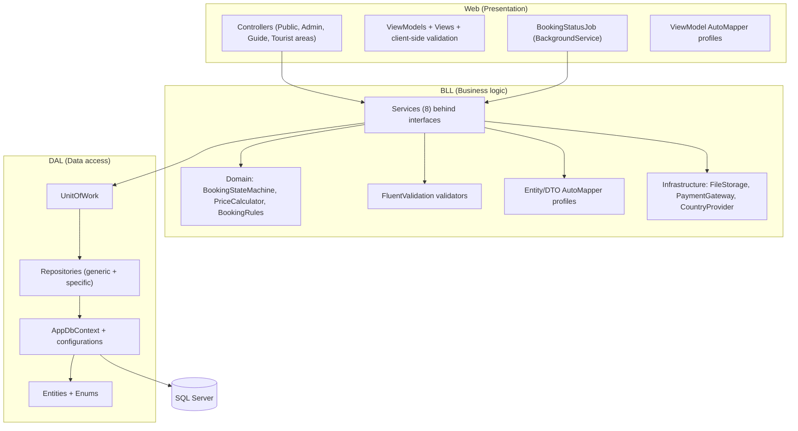

### 2.2 Use cases by actor

Each use case below has its own class diagram in section 5.

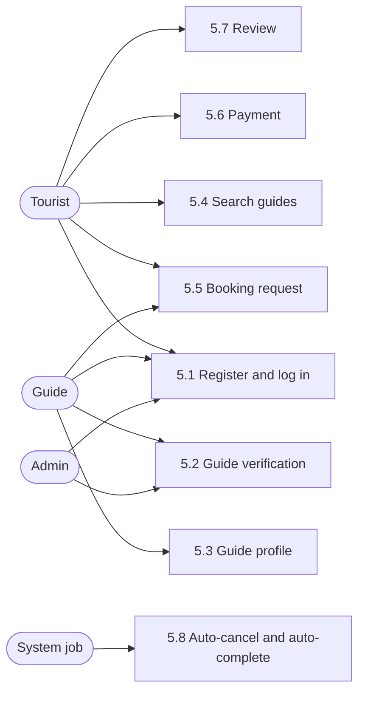

---

## 3. Domain model

All 10 entities and 5 enums live in `TourGuide.DAL/Entities` and `TourGuide.DAL/Enums`. The model is shown in three parts: relationships only, then the guide side and the booking side with every property.

### 3.1 Relationships at a glance

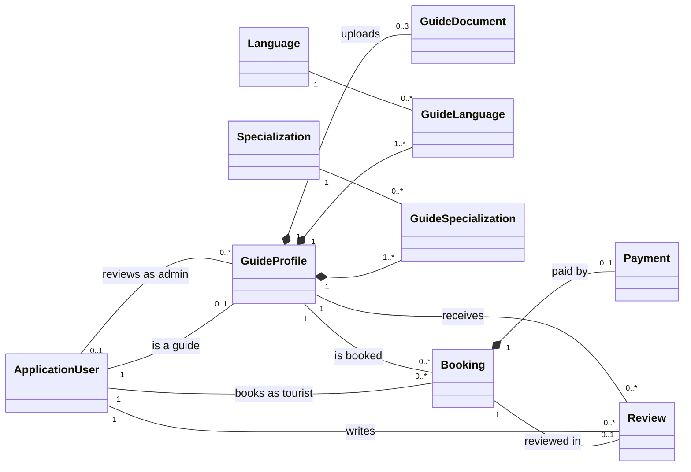

### 3.2 Guide side: accounts, guides, documents, languages, specializations

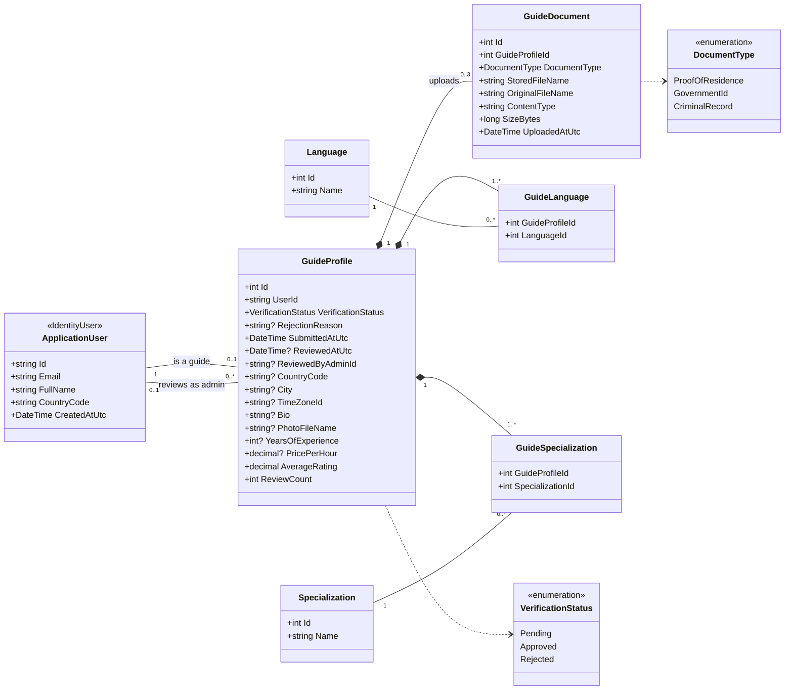

- One `GuideDocument` per `DocumentType` (unique `GuideProfileId` + `DocumentType`), so at most 3.
- `1..*` on the join classes applies once the profile is complete. A new guide has none yet.

### 3.3 Booking side: bookings, payments, reviews

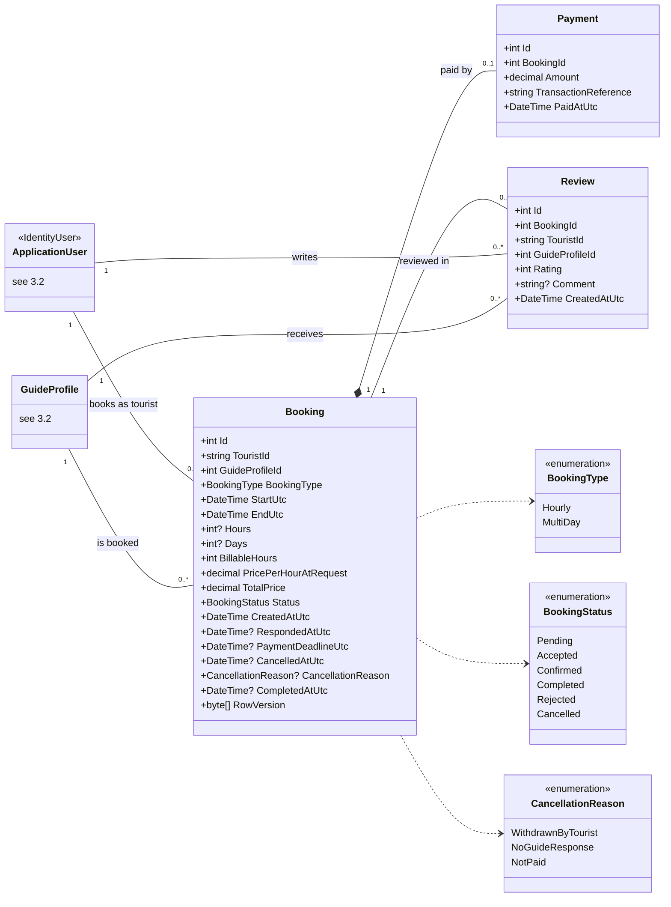

- `Booking.PricePerHourAtRequest` is a copy of the guide's price when the request was sent; later price changes don't affect it.
- `Review.GuideProfileId` and `Review.TouristId` are copied from the booking so profile pages load fast.

## 4. State diagrams

### 4.1 Booking status

`IBookingStateMachine` is the only code allowed to make these changes (BR-05 to BR-10). Any change not drawn here is refused with `ErrorCodes.InvalidStatusChange`.

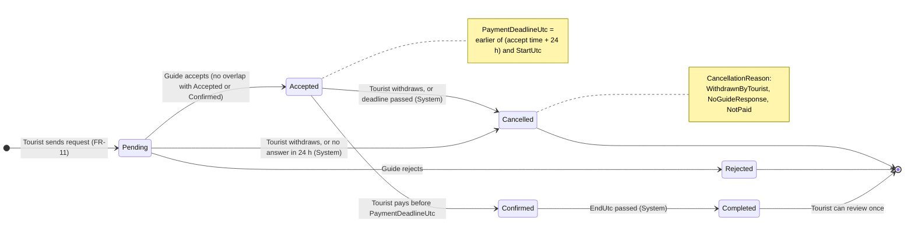

| From | To | Who | Condition | Sets |
| --- | --- | --- | --- | --- |
| — | Pending | Tourist | Guide approved and profile complete; valid request | `CreatedAtUtc`, prices |
| Pending | Accepted | Guide (owner) | No overlap with the guide's Accepted or Confirmed bookings | `RespondedAtUtc`, `PaymentDeadlineUtc` |
| Pending | Rejected | Guide (owner) | — | `RespondedAtUtc` |
| Pending | Cancelled | Tourist (owner) | — | `CancelledAtUtc`, `WithdrawnByTourist` |
| Pending | Cancelled | System | 24 h after `CreatedAtUtc` | `CancelledAtUtc`, `NoGuideResponse` |
| Accepted | Confirmed | Tourist (owner) | Before `PaymentDeadlineUtc`; a `Payment` is saved in the same transaction | — |
| Accepted | Cancelled | Tourist (owner) | — | `CancelledAtUtc`, `WithdrawnByTourist` |
| Accepted | Cancelled | System | `PaymentDeadlineUtc` passed | `CancelledAtUtc`, `NotPaid` |
| Confirmed | Completed | System | `EndUtc` passed | `CompletedAtUtc` |

### 4.2 Guide verification status

A guide is shown in search and can be booked only when **Approved and the profile is complete** (BR-01, BR-02).

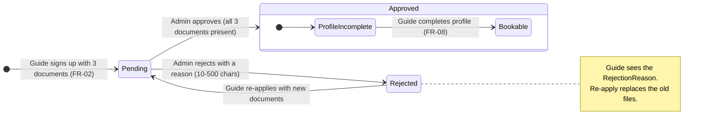

| State | Guide can... | Shown in search |
| --- | --- | --- |
| Pending | See "waiting for review" | No |
| Rejected | See the reason and re-apply | No |
| Approved, profile incomplete | Fill in the profile | No |
| Approved, profile complete (Bookable) | Receive and answer requests | Yes |

---

## 5. Class diagrams by use case

Each diagram follows one use case from the controller down to the entities. Classes shared by many cases (for example `IUnitOfWork`, `Result`) appear in full only in section 6.

### 5.1 Register and log in

**Actors:** Tourist, Guide, Admin · **FRs:** FR-01, FR-02, FR-03 · **Rules:** public sign-up creates only Tourist or Guide; admins are seeded.

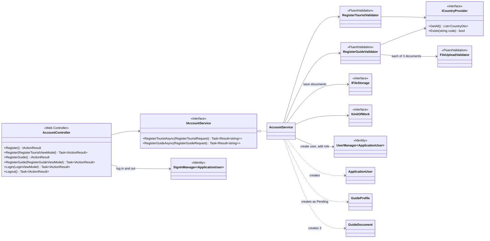

| Class | Responsibility |
| --- | --- |
| `AccountController` | Sign-up forms for both roles, log in, log out. Uses `SignInManager` only for the HTTP sign-in. |
| `AccountService` | Creates the user with `UserManager`, adds the role, and for a guide also saves the 3 files and creates `GuideProfile` + 3 `GuideDocument` rows in one transaction. |
| `RegisterTouristValidator` | Full name 2–100, valid email, country code in the list. |
| `RegisterGuideValidator` | Same as tourist, plus all 3 documents present and valid. |

### 5.2 Guide verification

**Actors:** Admin, Guide · **FRs:** FR-04 to FR-07 · **Rules:** BR-01, BR-03; reason required on reject; re-apply only from Rejected.

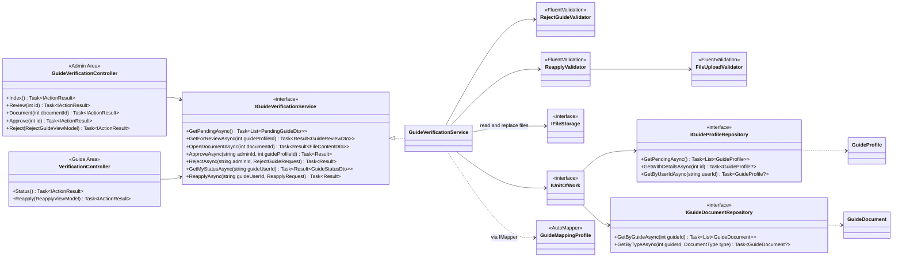

| Class | Responsibility |
| --- | --- |
| `GuideVerificationController` | Admin only (`[Authorize(Roles = Roles.Admin)]`). Lists pending guides, shows documents, approves or rejects. `Document` streams the file; it is never a public URL. |
| `VerificationController` | Guide only. Shows the current status and reason, and the re-apply form. |
| `GuideVerificationService` | Checks the status rules: approve needs 3 documents; reject needs a reason; re-apply only from Rejected and sets status back to Pending. |

### 5.3 Guide profile

**Actors:** Guide (edit), Tourist (view) · **FRs:** FR-08, FR-09 · **Rules:** only approved guides edit; profile complete = country, city, time zone, price, at least 1 language and 1 specialization.

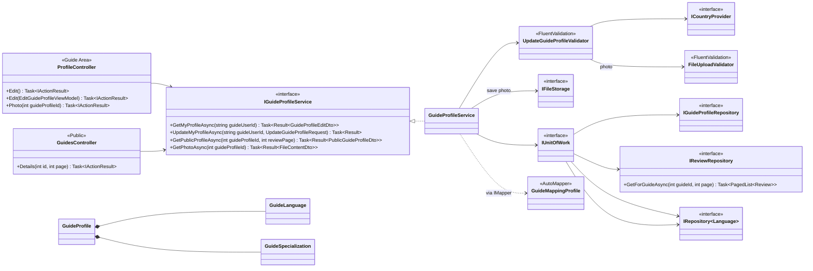

| Class | Responsibility |
| --- | --- |
| `ProfileController` | Guide only. Edit form for country, city, time zone, languages, specializations, price, bio, experience, photo. |
| `GuidesController` | Public profile page with average rating, reviews (paged) and a Book button. |
| `GuideProfileService` | Refuses edits unless the guide is Approved. Replaces the language and specialization lists as a whole. |
| `UpdateGuideProfileValidator` | Price > 0 and ≤ 1,000; experience 0–60; bio ≤ 1,000; ≥ 1 language and specialization; valid time zone id; photo JPG/PNG ≤ 5 MB. |

### 5.4 Search guides

**Actor:** Tourist · **FR:** FR-10 · **Rule:** only Approved guides with a complete profile (BR-02).

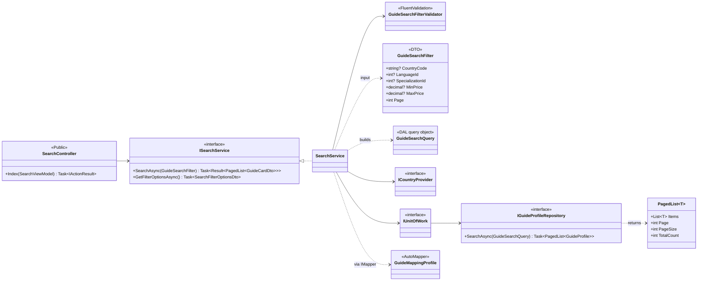

| Class | Responsibility |
| --- | --- |
| `SearchService` | Validates the filter, turns it into a `GuideSearchQuery`, maps results to `GuideCardDto`. |
| `GuideSearchFilterValidator` | Min price ≤ max price; prices ≥ 0; page ≥ 1. |
| `IGuideProfileRepository.SearchAsync` | Always adds "Approved and profile complete" to the query. |
| `PagedList<T>` | Lives in DAL (`Common/`) so both DAL and BLL can use it. |

### 5.5 Booking request

**Actors:** Tourist, Guide · **FRs:** FR-11, FR-12, FR-13, FR-15, FR-16 · **Rules:** BR-04 to BR-09, BR-11.

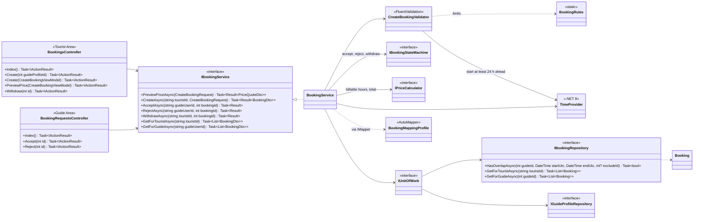

| Class | Responsibility |
| --- | --- |
| `BookingsController` | Tourist: request form, live price preview (FR-12), my bookings list, withdraw. |
| `BookingRequestsController` | Guide: incoming requests list (FR-13, FR-16), accept, reject. |
| `BookingService` | Checks the guide is bookable, copies the price, converts local times to UTC with the guide's `TimeZoneId`, checks overlap on accept, and changes status only through `IBookingStateMachine`. Saves with `RowVersion` so two changes can't collide. |
| `CreateBookingValidator` | Hourly: 2–10 hours, same local day. MultiDay: 2–14 days. Start ≥ now + 24 h. |

### 5.6 Payment

**Actor:** Tourist · **FR:** FR-14 · **Rules:** BR-07, BR-08, BR-12, NFR-04 (no card data stored).

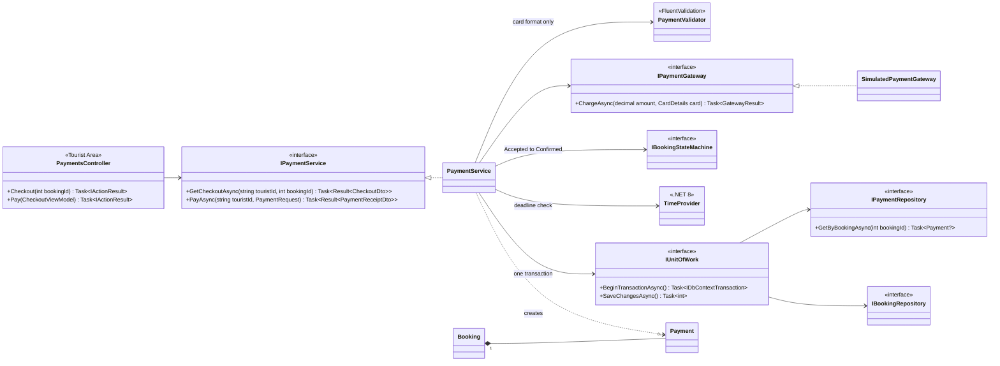

| Class | Responsibility |
| --- | --- |
| `PaymentService` | Checks the booking is Accepted, owned by the tourist, and before the deadline; calls the gateway; saves `Payment` and sets `Confirmed` in one transaction. Card details are passed to the gateway and then dropped. |
| `SimulatedPaymentGateway` | Always succeeds and returns a new GUID as `TransactionReference`. A real gateway later is a new class behind `IPaymentGateway`. |
| `PaymentValidator` | Card number digits and length, expiry in the future, CVV 3–4 digits. |

### 5.7 Review

**Actor:** Tourist · **FRs:** FR-09, FR-19, FR-20 · **Rules:** BR-13 to BR-15.

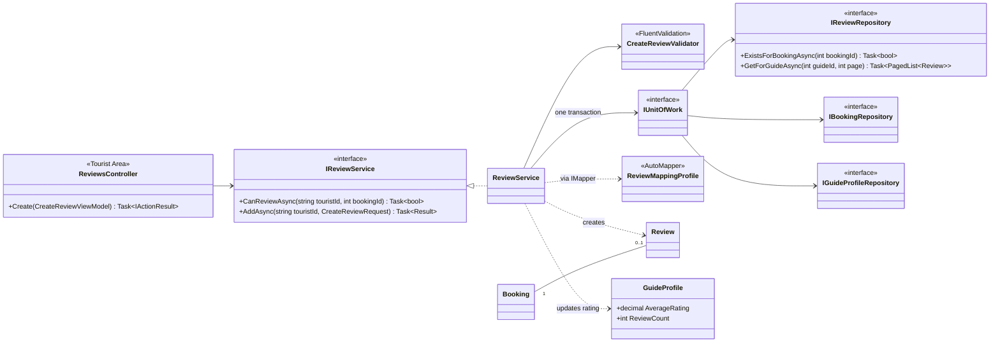

| Class | Responsibility |
| --- | --- |
| `ReviewService` | Checks the booking is Completed, belongs to the tourist, and has no review yet. Saves the review and updates `AverageRating` and `ReviewCount` in one transaction. |
| `CreateReviewValidator` | Rating 1–5 whole number; comment ≤ 1,000 characters. |

### 5.8 Auto-cancel and auto-complete (System job)

**Actor:** System · **FRs:** FR-17, FR-18 · **Rules:** BR-06, BR-08, BR-10, NFR-06.

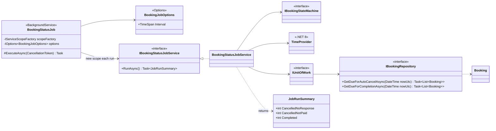

| Class | Responsibility |
| --- | --- |
| `BookingStatusJob` | Runs every `Interval` (from `appsettings.json`). Creates a DI scope each run and logs the `JobRunSummary`. No rules here. |
| `BookingStatusJobService` | Pending older than 24 h → Cancelled (`NoGuideResponse`); Accepted past `PaymentDeadlineUtc` → Cancelled (`NotPaid`); Confirmed past `EndUtc` → Completed. |

---

## 6. Layer reference

### 6.1 DAL: repositories, Unit of Work, DbContext

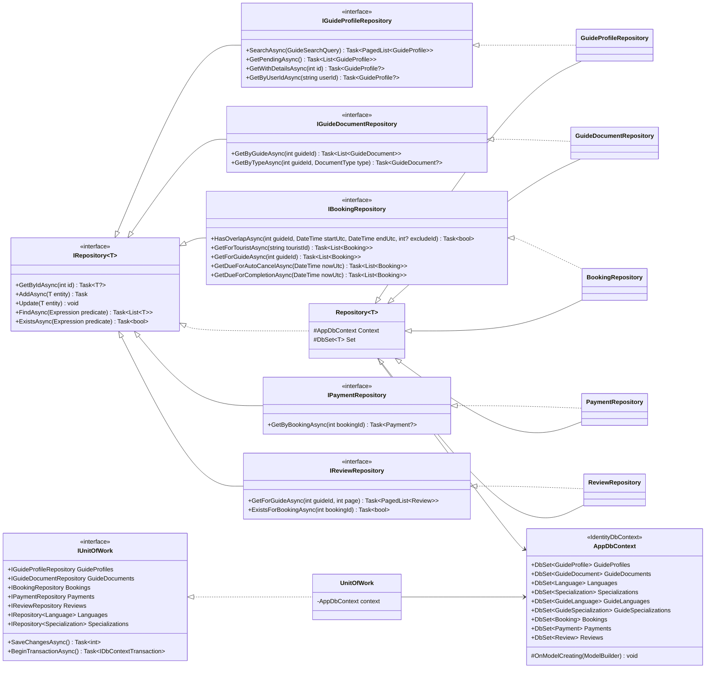

- Repositories never call `SaveChanges` and never return `IQueryable`. No `Delete` exists.
- `PagedList<T>` and `GuideSearchQuery` live in `TourGuide.DAL/Common` and `TourGuide.DAL/Queries`.

### 6.2 BLL shared classes: domain, infrastructure, results, options

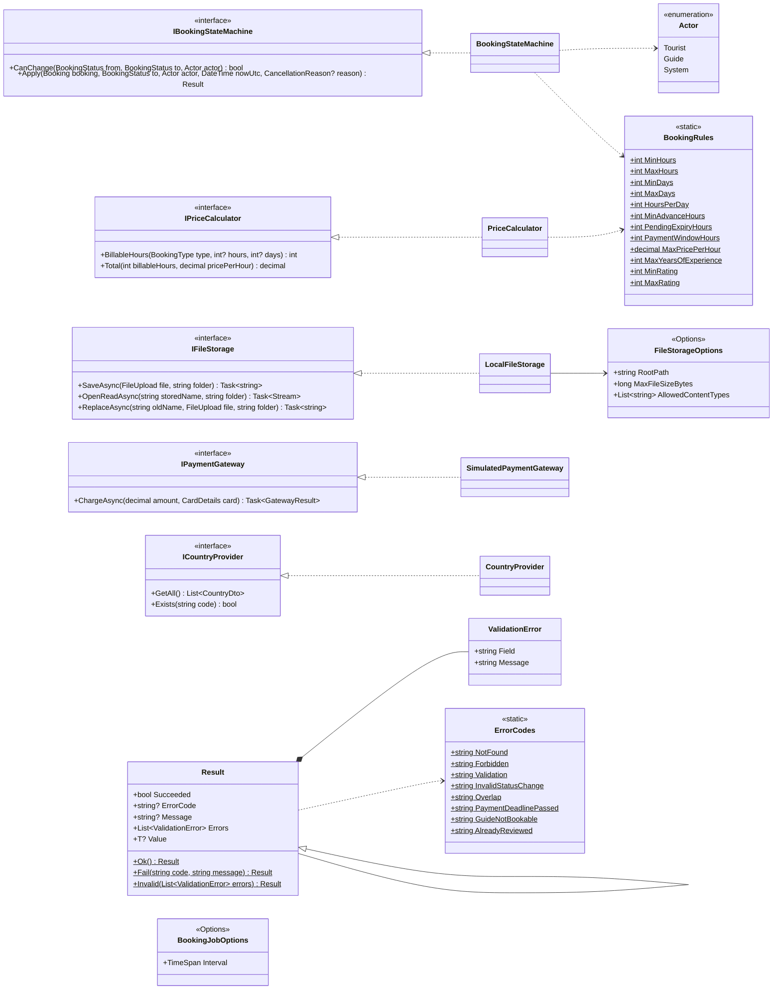

- `Actor` is a BLL enum used only by the state machine to know who asks for a change. It is not stored.
- `BookingRules` values: hours 2–10, days 2–14, 8 hours per day, 24 h advance, 24 h pending expiry, 24 h payment window, max price 1,000, max experience 60, rating 1–5.

### 6.3 Validators and AutoMapper profiles

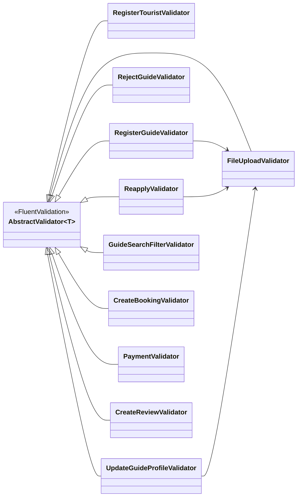

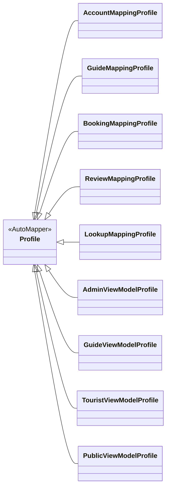

| Validator | Validates | Key rules |
| --- | --- | --- |
| `RegisterTouristValidator` | `RegisterTouristRequest` | Name 2–100, email, country in list |
| `RegisterGuideValidator` | `RegisterGuideRequest` | As tourist + 3 valid documents |
| `RejectGuideValidator` | `RejectGuideRequest` | Reason 10–500 |
| `ReapplyValidator` | `ReapplyRequest` | 3 valid documents |
| `UpdateGuideProfileValidator` | `UpdateGuideProfileRequest` | Price, experience, bio, lists, time zone, photo |
| `GuideSearchFilterValidator` | `GuideSearchFilter` | Min ≤ max price, page ≥ 1 |
| `CreateBookingValidator` | `CreateBookingRequest` | Hours/days by type, start ≥ now + 24 h, same-day end |
| `PaymentValidator` | `PaymentRequest` | Card format only |
| `CreateReviewValidator` | `CreateReviewRequest` | Rating 1–5, comment ≤ 1,000 |
| `FileUploadValidator` | `FileUpload` | PDF/JPG/PNG by content signature, ≤ 5 MB |

| Profile | Project | Maps |
| --- | --- | --- |
| `AccountMappingProfile` | BLL | Register requests → `ApplicationUser`, `GuideProfile` |
| `GuideMappingProfile` | BLL | `GuideProfile`, `GuideDocument` ↔ guide DTOs |
| `BookingMappingProfile` | BLL | `Booking` → booking DTOs; `CreateBookingRequest` → `Booking` (no price or status) |
| `ReviewMappingProfile` | BLL | `Review` ↔ review DTOs |
| `LookupMappingProfile` | BLL | `Language`, `Specialization` → `LookupDto` |
| `AdminViewModelProfile` | Web | Admin area DTOs ↔ ViewModels |
| `GuideViewModelProfile` | Web | Guide area DTOs ↔ ViewModels |
| `TouristViewModelProfile` | Web | Tourist area DTOs ↔ ViewModels |
| `PublicViewModelProfile` | Web | Home, account, search, public profile |

### 6.4 Web cross-cutting classes

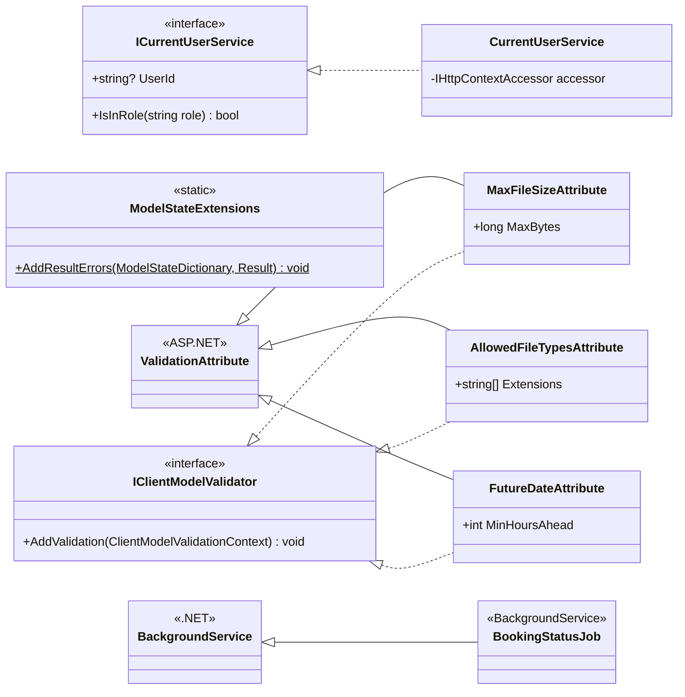

- Each custom attribute has a matching jQuery adapter in `wwwroot/js/validation.js`, so the same rule runs in the browser and on the server.
- `ModelStateExtensions.AddResultErrors` copies a failed `Result`'s field errors into `ModelState`, so FluentValidation errors appear under the right field.

---

## 7. Catalog

### 7.1 DTOs (BLL)

| Feature | Request DTOs (input) | Response DTOs (output) |
| --- | --- | --- |
| Account | `RegisterTouristRequest`, `RegisterGuideRequest` | — |
| Verification | `RejectGuideRequest`, `ReapplyRequest` | `PendingGuideDto`, `GuideReviewDto`, `GuideStatusDto`, `GuideDocumentDto` |
| Profile | `UpdateGuideProfileRequest` | `GuideProfileEditDto`, `PublicGuideProfileDto`, `ReviewDto` |
| Search | `GuideSearchFilter` | `GuideCardDto`, `SearchFilterOptionsDto`, `LookupDto`, `CountryDto` |
| Booking | `CreateBookingRequest` | `BookingDto`, `PriceQuoteDto` |
| Payment | `PaymentRequest` (contains `CardDetails`) | `CheckoutDto`, `PaymentReceiptDto`, `GatewayResult` |
| Review | `CreateReviewRequest` | `ReviewDto` |
| Shared | `FileUpload` (name, content type, stream, size) | `FileContentDto`, `JobRunSummary` |

### 7.2 ViewModels (Web)

| Area | ViewModels | Screen (SRS section 8) |
| --- | --- | --- |
| Public | `RegisterTouristViewModel`, `RegisterGuideViewModel`, `LoginViewModel` | Register, Log in |
| Public | `SearchViewModel`, `GuideCardViewModel` | Guide list |
| Public | `PublicGuideProfileViewModel` | Public guide profile |
| Admin | `PendingGuidesViewModel`, `GuideReviewViewModel`, `RejectGuideViewModel` | Admin screens |
| Guide | `GuideDashboardViewModel`, `EditGuideProfileViewModel`, `GuideStatusViewModel`, `ReapplyViewModel` | Guide dashboard, profile edit |
| Tourist | `CreateBookingViewModel`, `MyBookingsViewModel`, `CheckoutViewModel`, `CreateReviewViewModel` | Booking form, My Bookings, Payment, Review |

### 7.3 EF Core configurations (DAL)

One `IEntityTypeConfiguration<T>` per entity in `Data/Configurations/`.

| Configuration | Keys and indexes | Constraints |
| --- | --- | --- |
| `ApplicationUserConfiguration` | Identity defaults | FullName ≤ 100, CountryCode char(2) |
| `GuideProfileConfiguration` | Unique `UserId`; index (`VerificationStatus`, `CountryCode`) | Price `decimal(10,2)` 0–1,000; experience 0–60; rating `decimal(3,2)` |
| `GuideDocumentConfiguration` | Unique (`GuideProfileId`, `DocumentType`) | Size > 0 and ≤ 5,242,880 |
| `LanguageConfiguration` | Unique `Name` | Name ≤ 50 |
| `SpecializationConfiguration` | Unique `Name` | Name ≤ 50 |
| `GuideLanguageConfiguration` | Key (`GuideProfileId`, `LanguageId`) | — |
| `GuideSpecializationConfiguration` | Key (`GuideProfileId`, `SpecializationId`) | — |
| `BookingConfiguration` | Index (`GuideProfileId`, `Status`, `StartUtc`); index `TouristId`; `RowVersion` | Hours 2–10 or null; Days 2–14 or null; money `decimal(10,2)` |
| `PaymentConfiguration` | Unique `BookingId`; unique `TransactionReference` | Amount `decimal(10,2)` |
| `ReviewConfiguration` | Unique `BookingId`; index `GuideProfileId` | Rating 1–5; Comment ≤ 1,000 |

All relationships use `DeleteBehavior.Restrict`, because nothing is deleted.
